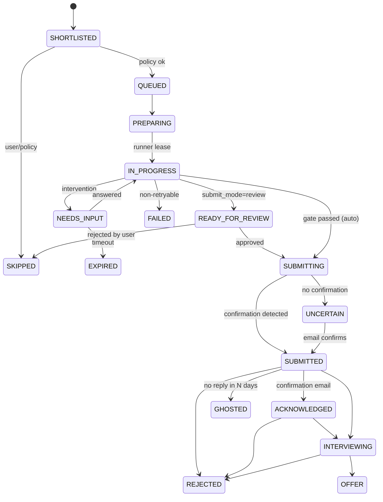

# Agents and workflows

Status: In review

## 1. Philosophy: "agentic where it pays, deterministic everywhere else"

"Agents" in JobOS are **bounded specialists** inside durable workflows — not one free-roaming agent. Each has a narrow job, typed inputs/outputs (structured outputs), a token/step budget, and a fixed tool set. Orchestration (what happens next, retries, waiting for humans) is code in Temporal, not LLM decisions. This gives us reproducibility, testability, cost control, and safety.

## 2. The agent roster

| Agent | Input | Output | LLM? | Tools |
|---|---|---|---|---|
| **Profile Builder** | Resume files, LinkedIn export, user edits | Master profile draft + confidence + questions | Yes | none (pure extraction) |
| **Scout** (discovery) | Search profile | Raw postings | No (connectors); LLM only to parse unstructured alert emails / career pages | HTTP fetch via sources package |
| **Resolver** | Posting | Canonical job, ATS URL, confidence | Mostly no (fuzzy match); LLM tie-breaker | ATS index lookup, careers page fetch |
| **Verifier** | Canonical job + company data | Legitimacy score + reasons | Rules + LLM for scam-language analysis | DNS/WHOIS, ATS index, history |
| **Matcher** | Job + profile + preferences | Fit score, reasons, gaps | Yes (rubric) + embeddings | none |
| **Tailor** | Job + profile | Resume variant (JSON) + cover letter, each claim linked to profile facts | Yes | grounding checker |
| **Form Resolver** | FormSchema + profile + answer bank + job | Fill plan with value/source/confidence per field | Yes (structured output) | answer-bank search |
| **Navigator** (fallback) | Unknown page + goal | Next safe action (click/type/upload/select) | Yes (browser-use / computer use) | restricted browser tools — **no submit** |
| **Inbox Clerk** | Email message | Classification, linked application, extracted facts (dates, links, OTP) | Yes (small) | application lookup |
| **Reviewer** (quality gate) | Fill plan + job | Issues list (inconsistency, tone, policy) | Yes | none |

Default model: `claude-opus-5-5` for all LLM agents. Per-agent model/effort routing to Sonnet 5.5 / Haiku 5.5 only after evals show no quality loss and with founder approval (DECISIONS-NEEDED Q9). All calls go through `packages/llm`.

## 3. Workflows (Temporal)

| Workflow | Trigger | Shape |
|---|---|---|
| `DiscoveryWorkflow(search_profile_id)` | Temporal Schedule (e.g. every 6h) / manual | fan-out per source → normalize → dedup/resolve → verify → match → enqueue shortlisted |
| `ApplicationWorkflow(application_id)` | Shortlisted job passes policy | prepare → acquire runner lease → page loop → gate → submit → evidence → done; waits on signals for interventions |
| `InterventionWorkflow` (child) | Any pause | notify → wait for `answer` signal or timeout → reminders → return |
| `InboxSyncWorkflow(mailbox_id)` | Push/poll | fetch new → classify → link → update application state → notify |
| `SessionHealthWorkflow(candidate_id)` | Daily + before apply batch | check logged-in status per site on runner → create LOGIN_REQUIRED interventions |
| `CanaryWorkflow(ats)` | Nightly | dry-run fill on live public postings, never submit → drift alerts |
| `ApplyBudgetWorkflow(candidate_id)` | Continuous | releases queued applications respecting caps, active hours, per-site pacing |

### Determinism rules
- Workflows contain only orchestration; all I/O (DB, HTTP, LLM, browser) happens in activities.
- Activity idempotency keys: `application_id + attempt + step`.
- Long waits use Temporal timers/signals (no polling loops).

## 4. Application state machine

Rules:
- `UNCERTAIN` is never auto-retried (risk of double application). It requires inbox confirmation or a human decision.
- Transitions are written by one module (`packages/core/state.py`) with an append-only `application_events` log.

## 5. Human-in-the-loop design

1. When any step can't proceed, it raises a typed `InterventionRequired(type, payload)`.
2. Workflow starts a child `InterventionWorkflow`; application → `NEEDS_INPUT`.
3. Notifier sends: dashboard card + Telegram/web push with **one-tap answers** where possible (yes/no, choose option, short text).
4. **Batching:** the Form Resolver collects *all* unresolved fields across all pages it can see before asking, so the user answers once per application, not once per field.
5. The answer is saved to the answer bank (with "remember for: all jobs / this company / this job only"), then signaled back; workflow resumes exactly where it paused (the runner keeps the page open if within a short window; otherwise replays deterministically from the last completed page).
6. Timeouts: reminder after 2h, expire after 48h (configurable) → application `EXPIRED`, can be re-queued.

## 6. Concurrency & pacing
- Per candidate: one active browser task per site account; global max concurrent tasks per runner (default 1 for local runner).
- Per site: min gap between submissions (randomized, e.g. 2–8 min), daily caps from policy.
- Active hours from the candidate's timezone.
