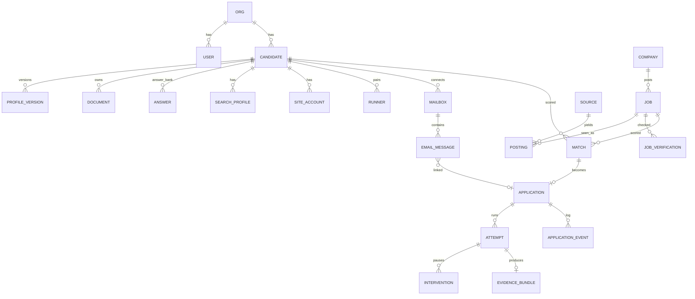

# Data model

Status: Draft — tables will be finalized in the P1 specs; this is the shape.

## 1. Tenancy
Every tenant-owned row has `org_id` and (where relevant) `candidate_id`. P1: one org, one candidate (the founder). Agency mode later = one org, many candidates, many operators. Postgres Row-Level Security policies enforce `org_id` isolation (defense in depth in addition to app checks).

## 2. Entity overview



Note: `COMPANY`, `JOB`, `POSTING`, `SOURCE`, `JOB_VERIFICATION` are **global** (shared across tenants, no PII). Everything candidate-related is tenant-scoped.

## 3. Key tables (abridged)

| Table | Key columns |
|---|---|
| `orgs`, `users`, `memberships` | role (`owner`, `operator`, `candidate`) |
| `candidates` | `org_id`, `user_id?`, timezone, locale, status |
| `profile_versions` | `candidate_id`, `version`, `data jsonb` (schema below), `created_by`, `created_at` — immutable rows; `candidates.current_profile_version` |
| `profile_sensitive` | encrypted blob: EEO, disability, veteran, DOB etc. |
| `documents` | kind (`resume`, `cover_letter`, `transcript`, …), storage key, sha256, parsed text, `is_default`, `variant_of`, `job_id?` |
| `answers` | `canonical_question`, `question_embedding vector`, `answer jsonb`, `scope` (`global`/`company`/`job`), `scope_ref`, `source` (`user`/`imported`/`generated_approved`), `confidence`, `last_used_at`, `use_count` |
| `search_profiles` | filters jsonb, policy jsonb (scores, caps, submit_mode, hours), schedule |
| `sources` | type, config, health |
| `companies` | name, normalized_name, domains[], ats_boards jsonb, size, linkedin_url, enrichment jsonb |
| `jobs` | canonical: company_id, title, normalized_title, seniority, locations jsonb, remote_type, salary jsonb, description, canonical_apply_url, ats_type, first_seen, last_seen, closed_at, embedding |
| `postings` | source_id, source_job_id, url, apply_url, raw jsonb, job_id, resolution_confidence, seen_at |
| `job_verifications` | job_id, score, signals jsonb, checked_at, version |
| `matches` | candidate_id, job_id, search_profile_id, fit_score, reasons jsonb, gaps jsonb, status (`new`, `shortlisted`, `dismissed`), user_feedback |
| `applications` | candidate_id, job_id, match_id, state, submit_mode, resume_document_id, temporal_workflow_id, submitted_at, outcome |
| `application_events` | append-only: from_state, to_state, actor (`system`/`user`/`email`), data, at |
| `attempts` | application_id, n, runner_id, started/ended, result, cost jsonb (tokens, $), error |
| `form_pages` | attempt_id, index, url, form_schema jsonb, fill_plan jsonb, verify_result jsonb, screenshot keys |
| `interventions` | attempt_id, type, payload jsonb, status (`open`, `answered`, `expired`, `cancelled`), answer jsonb, channel, created/answered_at |
| `evidence_bundles` | attempt_id, manifest jsonb, storage prefix, sha256, immutable |
| `site_accounts` | candidate_id, site (`google`, `linkedin`, `workday:<tenant>`…), username, credential_ref (vault), login_state, last_checked |
| `vault_secrets` | ciphertext, wrapped_dek, kms_key_id, purpose — never selected by default ORM queries |
| `runners` | candidate_id, kind (`local`/`cloud`), device_token_hash, version, last_seen, capabilities |
| `mailboxes` | candidate_id, kind (`forward`/`imap`/`gmail_api`), config (encrypted), cursor |
| `email_messages` | mailbox_id, message_id, from, subject, received_at, class, extracted jsonb, application_id?, raw_ref? (short retention) |
| `notifications` | channel, payload, status |
| `llm_calls` | trace id, agent, model, tokens in/out/cached, cost, latency, application_id? (also in Langfuse) |
| `audit_log` | actor, action, target, ip/runner, at — append-only |

## 4. Master profile schema (v0, JSON — superset of JSON Resume)
```jsonc
{
  "basics": {"first_name": "", "last_name": "", "preferred_name": "", "email": "", "phone": {"country_code": "+91", "number": ""},
             "location": {"city": "", "region": "", "country": "IN", "postal_code": ""},
             "links": {"linkedin": "", "github": "", "portfolio": "", "other": []},
             "headline": "", "summary": ""},
  "work": [{"company": "", "title": "", "start": "2022-07", "end": null, "location": "", "employment_type": "full_time",
            "highlights": [{"id": "w1h1", "text": "", "skills": [], "metrics": []}]}],
  "education": [{"institution": "", "degree": "", "field": "", "start": "", "end": "", "grade": {"scale": "CGPA/10", "value": ""}}],
  "skills": [{"name": "", "level": "expert|advanced|intermediate", "years": 0}],
  "projects": [], "certifications": [], "publications": [], "awards": [], "languages": [{"name": "", "proficiency": ""}],
  "work_authorization": [{"country": "IN", "status": "citizen", "needs_sponsorship": false}],
  "preferences": {"notice_period_days": 30, "current_comp": {"amount": 0, "currency": "INR", "period": "year"},
                  "expected_comp": {"min": 0, "currency": "INR", "period": "year"}, "relocation": ["Bengaluru"], "remote": "remote_or_hybrid"},
  "sensitive_ref": "profile_sensitive:<id>"   // EEO etc., stored encrypted separately
}
```
Every highlight/fact has an `id` so generated text (tailored resumes, answers) can cite exactly which facts it used (grounding check, ADR-0008).

## 5. Data lifecycle
- Soft delete → hard delete job after 30 days; full account deletion purges object storage prefixes, vault secrets, runner tokens, traces.
- Raw email bodies: default 90-day retention; extracted facts kept.
- Global job data retained for analytics (no PII).
