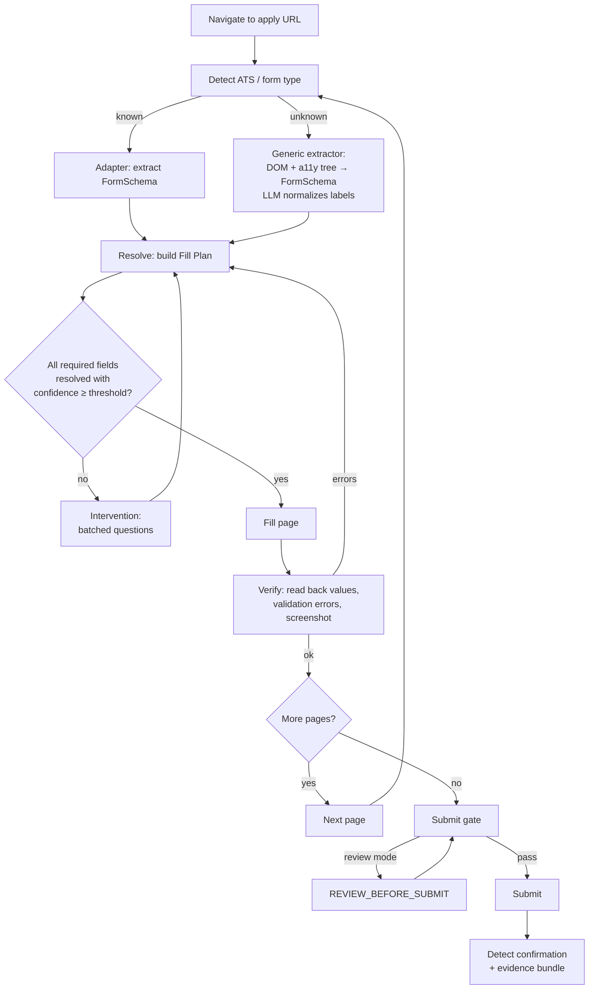

# Form-filling engine

Status: In review — ADR-0005. This is the heart of the product and the main IP.

## 1. Goal
Turn "here is an application URL" into a correct, complete, verified submission — or a precise question for the human — with every value traceable to a source.

## 2. Pipeline



## 3. Detection
Fingerprints by URL patterns and DOM markers, e.g. `boards.greenhouse.io` / `job-boards.greenhouse.io`, `jobs.lever.co`, `jobs.ashbyhq.com`, `*.myworkdayjobs.com`, `*.icims.com`, `jobs.smartrecruiters.com`, `apply.workable.com`, `docs.google.com/forms`, `forms.office.com`, plus embedded iframes on company career pages (Greenhouse/Lever embeds are common).

## 4. FormSchema (normalized)
```jsonc
{
  "page": {"index": 0, "title": "Apply", "url": "..."},
  "fields": [
    {
      "key": "q_123",                // stable id from adapter or hashed locator
      "label": "Are you legally authorized to work in India?",
      "type": "single_select",        // text|textarea|email|phone|number|date|single_select|multi_select|checkbox|file|url|location|consent
      "required": true,
      "options": ["Yes", "No"],
      "constraints": {"max_length": null, "accept": null},
      "section": "Screening",
      "locator": {"strategy": "role", "value": "..."}  // never shown to the LLM as instructions
    }
  ],
  "submit": {"locator": "..."},       // only the submit step may use it
  "next": {"locator": "..."}
}
```

## 5. Resolver chain (Fill Plan)
For each field, try in order; stop at first confident answer:
1. **Deterministic profile mapping** — name, email, phone, address, links, education, current company, etc. (canonical field taxonomy; adapters map known keys directly).
2. **Policy presets** — work authorization, sponsorship, EEO (default decline), salary, notice period, relocation.
3. **Answer bank match** — embedding search over canonical questions + LLM confirmation that the stored answer fits *this* question and option list. Respect scope (global/company/job).
4. **Grounded generation** — only for open-text questions that legitimately need composition (e.g. "Why do you want to join?"). Inputs restricted to profile facts, job description, company facts. Output flagged `generated` and always shown in review until the user enables auto-approve for generated text.
5. **Unresolved** → intervention.

Fill Plan entry:
```jsonc
{"key": "q_123", "value": "Yes", "source": "preset:work_auth.IN", "confidence": 0.99,
 "evidence": ["profile.work_authorization[IN]=citizen"], "generated": false}
```

Confidence thresholds per submit mode (configurable): `auto` ≥ 0.85; `auto_if_confident` ≥ 0.95 for all required fields else review.

## 6. Filling
- Adapter-specific actions where known (Workday's custom dropdowns, date widgets, multi-step "My Experience" sections).
- Generic action executor: Playwright role/label locators; handles native selects, ARIA comboboxes (type + choose), radios, checkboxes, file uploads, contenteditable, date pickers (type ISO → fallback to picker), location autocompletes.
- Uploads: resume variant PDF and cover letter from object storage, cached locally on runner.
- After each page: read back every field value; collect inline validation errors; screenshot.

## 7. Fallback navigation (unknown flows)
When the page is not a form we understand (interstitial, "Apply with…" chooser, account wall):
- **Navigator** agent (browser-use, or Claude computer use for canvas-like pages) gets a goal ("reach the application form for job X") and a **restricted tool set**: click, type into non-sensitive fields, scroll, go back, wait. It **cannot** submit, cannot enter credentials, cannot navigate off allowed domains (job's ATS + company domain + identity providers).
- Step and token budgets per attempt (e.g. 25 steps). On exhaustion → `UNKNOWN_PAGE` intervention.
- Successful navigation paths are cached per domain (idea borrowed from Stagehand's action caching) so the next run is deterministic.

## 8. Submit gate (the only path to a final click)
Checks, all must pass:
1. Every required field filled; no validation errors on read-back.
2. Every value has a source; no `generated` values unapproved under current policy.
3. Confidence thresholds met.
4. Duplicate check (canonical job, company+role window).
5. Policy: caps, active hours, legitimacy ≥ min, match ≥ min, company not excluded.
6. Liveness: job still open.
7. Submit mode: `always_review` → human approval recorded.
Gate result and inputs are stored in the evidence bundle.

## 9. Confirmation & evidence
- Confirmation detection: ATS-specific success markers / URL changes / "thank you" text; else `UNCERTAIN` (state machine).
- Evidence bundle: Fill Plan (final), FormSchema per page, screenshots per page (pre-submit and post-submit), uploaded file hashes, gate result, timestamps, runner id, profile version.

## 10. Adapter interface (sketch)
```python
class AtsAdapter(Protocol):
    ats: AtsType
    def matches(self, url: str, page: Page) -> bool: ...
    async def open(self, page: Page, job: Job) -> None: ...              # reach the form (incl. login/account flow)
    async def extract(self, page: Page) -> FormSchema: ...
    async def fill(self, page: Page, plan: FillPlan) -> FillResult: ...
    async def next_page(self, page: Page) -> bool: ...
    async def submit(self, page: Page, gate_token: GateToken) -> SubmitResult: ...  # requires a token only the gate issues
    async def confirmation(self, page: Page) -> Confirmation | None: ...
```
`GateToken` is an unforgeable object issued by the submit gate for this attempt; adapters cannot submit without it.

## 11. Testing
Each adapter ships with recorded HTML fixtures and golden FormSchema/FillPlan files; a fake-ATS test server replays multi-page flows; nightly canaries dry-run on live postings (testing-strategy.md).
