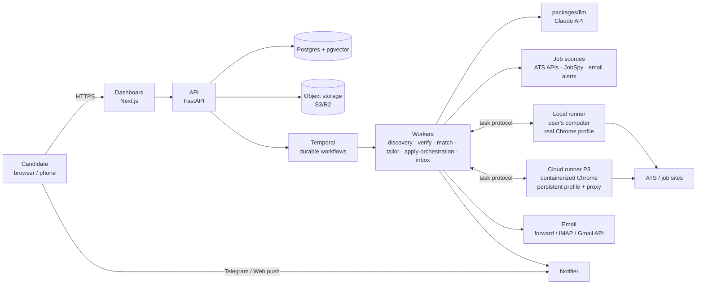
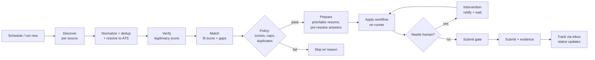

# Architecture overview

Status: In review. Depends on ADR-0002 (stack), 0003 (Temporal), 0004 (runners), 0005 (form engine).

## 1. System context

## 2. Components

| Component | Responsibility | Tech |
|---|---|---|
| **Dashboard (`apps/web`)** | All UI: pipeline, feed, interventions, profile, answer bank, connections, settings, analytics | Next.js (App Router), TS, Tailwind, shadcn/ui, TanStack Query, generated API client |
| **API (`apps/api`)** | Auth, CRUD, commands (start search, answer intervention), runner registration, webhooks, SSE/WebSocket for live updates | FastAPI, Pydantic v2, SQLAlchemy 2 |
| **Workers (`apps/worker`)** | Temporal workflows + activities for every pipeline stage | Temporal Python SDK |
| **Runner (`apps/runner`)** | Executes browser tasks: login checks, form extraction, filling, submit, evidence capture. Talks to control plane over an outbound authenticated channel | Python, Playwright, real Chrome |
| **Form engine (`packages/form-engine`)** | Extract → resolve → gate → fill → verify → submit; ATS detection | Python |
| **ATS adapters (`packages/ats-adapters`)** | Deterministic per-ATS flows (Greenhouse, Lever, Ashby, Workday, …) | Python + Playwright |
| **Sources (`packages/sources`)** | Discovery connectors, normalization, dedup, ATS resolution | Python, httpx, JobSpy |
| **LLM gateway (`packages/llm`)** | Single entry to Claude: prompts, model routing, caching, budgets, structured outputs, tracing | Anthropic Python SDK, Langfuse |
| **Core (`packages/core`)** | Domain models, state machines, policies, schemas shared by api/worker/runner | Python, Pydantic |
| **Notifier** | Web push, Telegram bot, email digests | Worker activities + bot webhook in API |
| **Postgres** | System of record; pgvector for answer-bank & job embeddings | Postgres 16+ |
| **Object storage** | Resumes, rendered PDFs, screenshots, evidence bundles | S3-compatible |
| **Temporal** | Durable execution, retries, timers, signals (human answers), schedules | Temporal Cloud or self-hosted |

## 3. The pipeline (end to end)

Each arrow is a Temporal activity or child workflow. Every stage is idempotent and keyed by stable IDs, so retries never duplicate an application.

## 4. Key architectural decisions (see ADRs)
1. **Control plane in the cloud, execution plane wherever the browser is.** The runner pulls tasks over an outbound connection, so a laptop behind NAT works and the same protocol serves cloud runners later (ADR-0004).
2. **Durable workflows** model the long-running, human-paused process (ADR-0003).
3. **Deterministic first, LLM second.** Adapters and structured "fill plans" make behavior testable and cheap; LLMs resolve meaning, not clicks (ADR-0005).
4. **Single submit gate** — the only path to a final click (ADR-0005).
5. **Grounded generation** with provenance per field (ADR-0008).
6. **Multi-tenant data model from day 1** (`org_id` + `candidate_id` on every row), even while only the founder uses it — enables agency mode later without migration pain.

## 5. Deployment views

**P1 (founder):** Docker Compose on the founder's machine or one small VM: Postgres, Temporal (dev server), API, worker, web; runner runs natively on the laptop with real Chrome.

**P3 (product):** managed Postgres (with PITR), Temporal Cloud, containerized API/worker/web on a container platform (decision Q7), object storage, CDN for web, cloud runners as autoscaled container pool with per-user persistent profiles, secrets in cloud KMS.

## 6. Related docs
- [agents-and-workflows.md](agents-and-workflows.md)
- [browser-execution.md](browser-execution.md)
- [form-filling-engine.md](form-filling-engine.md)
- [data-model.md](data-model.md)
- [security-and-privacy.md](security-and-privacy.md)
- [reliability-observability.md](reliability-observability.md)
- [tech-stack.md](tech-stack.md)
