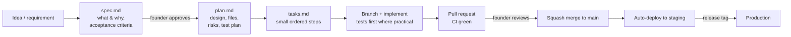

# How we work

Status: In review

Team: **Founder** (product owner, reviewer, local testing, keys/accounts) + **Claude** (research, specs drafts, implementation, tests, CI) + optional other coding agents. The workflow is designed so the founder spends time on decisions and review, not typing code.

## 1. Lifecycle of a piece of work

1. **Spec** (`docs/specs/NNNN-slug/spec.md`) — problem, user stories, linked PRD IDs, acceptance criteria (testable), out of scope, security/privacy considerations, open questions. **Founder approves** by merging the spec PR (or commenting "approved").
2. **Plan** (`plan.md`) — architecture of the change, data/API changes, alternatives, test plan, rollout/flags, observability. New significant decisions → ADR.
3. **Tasks** (`tasks.md`) — checklist of small steps, each ≤ ~half a day, each leaving `main` green.
4. **Implement** on a short-lived branch; open a **draft PR early**; keep PRs small (< ~400 changed lines excluding fixtures/generated code where possible).
5. **Review** — CI must pass; founder reviews behavior/UX/product; Claude self-reviews with `/code-review` and `/security-review` for sensitive areas.
6. **Merge** — squash merge, Conventional Commit title; delete branch.
7. **Deploy** — `main` auto-deploys to staging (from P3); production via release tags.

Small changes (typos, dependency bumps, one-line fixes) skip spec/plan: PR description is enough.

## 2. Branching & commits
- Trunk-based: `main` is always releasable. Branches: `feat/<spec-no>-<slug>`, `fix/<slug>`, `docs/<slug>`, `chore/<slug>`.
- Conventional Commits; PR title becomes the squash commit.
- Branch protection on `main`: PR required, CI required, linear history, no force-push.
- Feature flags for anything user-visible that isn't complete.

## 3. Definition of Ready (for a spec to start)
- Acceptance criteria are testable; PRD IDs linked; open questions answered or explicitly deferred; dependencies done.

## 4. Definition of Done (for a PR)
- [ ] Acceptance criteria met and demonstrated (tests + screenshots/recording for UI or browser flows)
- [ ] Unit/integration tests added; coverage not reduced in touched packages
- [ ] Lint, types, tests, license & secret scans green
- [ ] Docs updated (spec/plan/tasks, architecture, ADR if needed, `.env.example`)
- [ ] Observability: logs/traces/metrics for new paths
- [ ] Security considerations addressed (spec section)
- [ ] No TODOs without an issue link

## 5. Collaboration between founder and Claude
- **Claude** works in cloud sessions on the GitHub repo: creates branches, commits, pushes, opens PRs (when asked), runs tests and browser checks in its container.
- **Founder** pulls branches locally to run things that need real accounts, real Chrome sessions, or secrets (the local runner, Gmail, Telegram bot), and reports results on the PR.
- Secrets never go into chat or the repo. Local: `.env`. CI/cloud: GitHub Actions secrets / cloud secret manager.
- Decisions requested from the founder are always written into `docs/DECISIONS-NEEDED.md` with options and a recommendation.

## 6. Work tracking
- GitHub Issues for bugs and small tasks; GitHub Projects board with columns `Backlog → Spec → Ready → In progress → Review → Done`.
- Each spec folder ↔ one issue (epic) with the spec number.
- Milestones = roadmap phases.

## 7. Releases & versioning
- Services: continuous deployment from `main` to staging; production release tags `vYYYY.MM.DD-N`.
- Runner app: semantic versioning; Runner Protocol versioned separately; control plane supports N-1 runner versions.
- Changelog generated from Conventional Commits.
